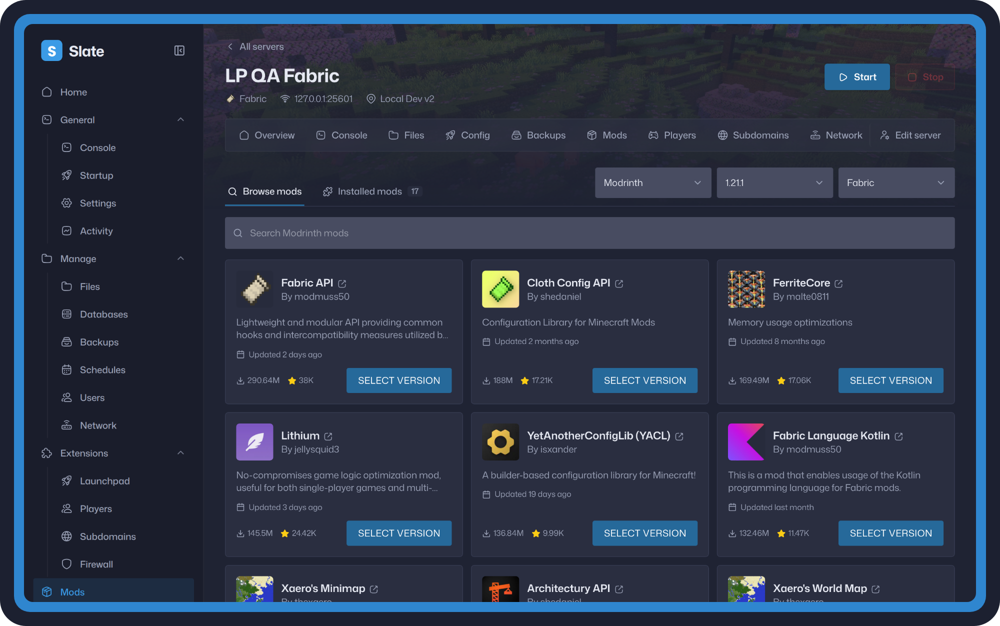
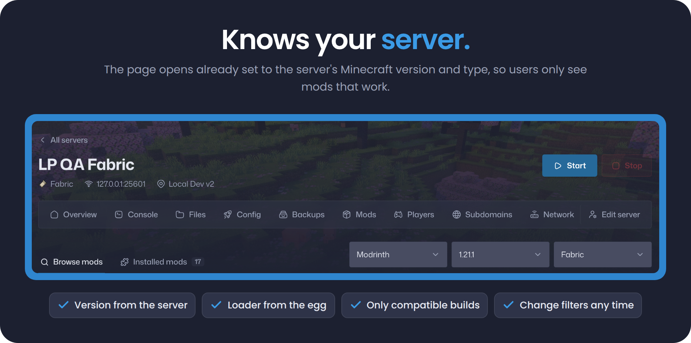
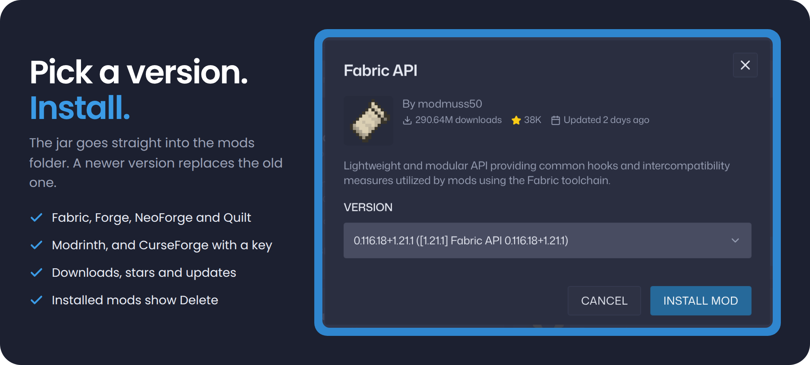
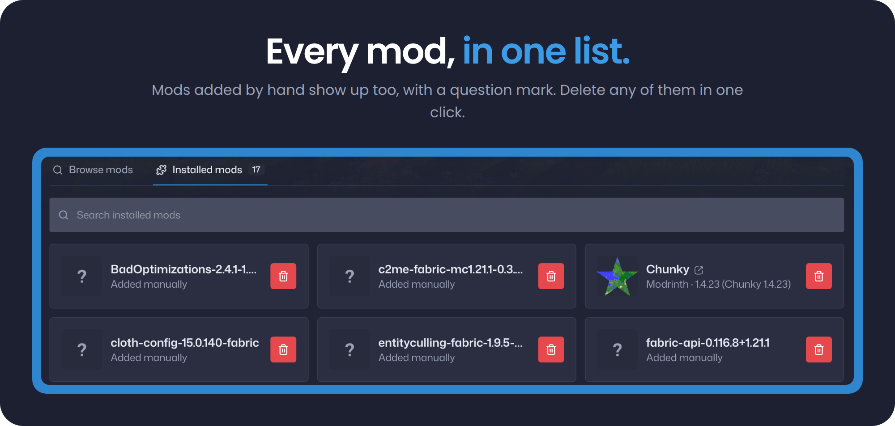

# Minecraft Mod Installer

A free Pterodactyl v2 extension. Users find and install Minecraft mods from Modrinth and CurseForge right from the panel, for Fabric, Forge, NeoForge and Quilt servers.






## Install

Upload the `.pteroext` in the panel under Extensions, or run:

```
php artisan p:extension:install mod-installer.pteroext --enable --replace
```

## Set up

- Pick which eggs show the Mods page in the extension settings.
- Add a CurseForge API key there to turn on CurseForge.

Want plugins instead? Check out [Minecraft Plugin Installer](https://github.com/wrrfsub/Minecraft-Plugin-Installer).


